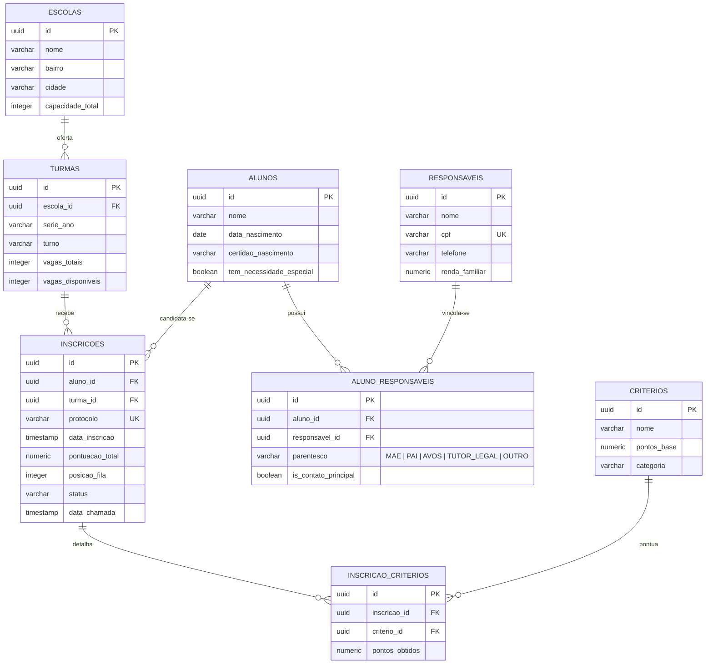

# SIVE — Sistema Integrado de Vagas Escolares (Backend)

O **SIVE** é uma aplicação voltada para a gestão transparente, organizada e automatizada de solicitações de vagas e filas de espera na educação infantil e ensino fundamental.

O sistema permite cadastrar escolas e turmas, receber inscrições de dependentes vinculados a responsáveis legais, pontuar as solicitações com base em critérios socioeconômicos e geográficos configuráveis, e gerenciar a convocação e matrícula dos alunos de forma concorrente e consistente.

---

## 1. Tecnologias Utilizadas

- **Linguagem:** Java 17+
- **Framework Web:** Spring Boot (Spring Web para rotas e controladores REST)
- **Banco de Dados:** PostgreSQL 16
- **Acesso a Dados:** JDBC Nativo (`java.sql`) com transações manuais
- **Containerização:** Docker e Docker Compose

---

## 2. Arquitetura e Conceitos Centrais

A aplicação adota uma arquitetura em camadas orientada a objetos:

```text
HTTP Request ──► Controller (REST) ──► Service (Regras de Negócio) ──► DAO (JDBC) ──► PostgreSQL
                                            │
                             ┌──────────────┴──────────────┐
                             ▼                             ▼
                  Strategy (Pontuação)          Tarefa (Threads Concorrentes)
```

### Padrão Strategy (Motor de Pontuação)
A pontuação de cada inscrição na fila varia de acordo com critérios sociais e geográficos. O sistema utiliza o padrão **Strategy** para desacoplar as regras de cálculo:
- `CriterioPontuacaoStrategy` (Interface base): define o contrato `double calcularPontos(Inscricao inscricao)`.
- Implementações concretas:
  - `CriterioRendaStrategy`: pontua inscrições com base na renda familiar per capita.
  - `CriterioProximidadeStrategy`: pontua a proximidade residencial do aluno em relação à escola.
  - `CriterioIrmaoStrategy`: concede pontuação adicional para alunos com irmãos matriculados na mesma escola.
  - `CriterioPcdStrategy`: aplica prioridade legal para candidatos com deficiência/necessidades especiais.
- `CriterioStrategyFactory`: fabrica e entrega a estratégia adequada para cada critério avaliado.

### Threads e Concorrência
O sistema opera em ambiente concorrente e aborda duas frentes:
1. **Processamento Concorrente de Filas (`tarefa`):** Operações demoradas, como recálculo de pontuação em lote ou geração de métricas de demanda, são executadas por tarefas independentes que implementam `Runnable` e rodam em `Thread` separadas, permitindo sincronização com `start()` e `join()`.
2. **Proteção contra Condições de Corrida (*Race Conditions*):** Métodos críticos de reserva e alocação de vagas utilizam bloqueios sincronizados (`synchronized`) e controle transacional no banco para garantir que duas requisições simultâneas não preencham a mesma vaga além da capacidade da turma.

### Tratamento Centralizado de Exceções
Regras de negócio violadas lançam exceções customizadas do pacote `exception` (ex.: `VagaIndisponivelException`, `AlunoJaInscritoException`, `InscricaoNaoEncontradaException`). O controlador `GlobalExceptionHandler` intercepta esses erros e retorna mensagens padronizadas em JSON com os devidos códigos de status HTTP (400, 404, 409).

---

## 3. Estrutura de Pastas e Pacotes

```text
backend/
├── docker-compose.yml              # Orquestração do PostgreSQL
├── pom.xml                         # Dependências do projeto Maven
├── README.md                       # Documentação técnica do projeto
├── sql/
│   └── schema.sql                  # Script DDL com a estrutura das tabelas
└── src/main/java/com/sive/
    ├── SiveApplication.java        # Inicializador da aplicação
    │
    ├── controller/                 # Controladores REST da API
    │   ├── EscolaController.java
    │   ├── TurmaController.java
    │   ├── ResponsavelController.java
    │   ├── InscricaoController.java
    │   └── GlobalExceptionHandler.java
    │
    ├── service/                    # Regras de negócio e coordenação de fluxo
    │   ├── InscricaoService.java
    │   ├── TurmaService.java
    │   └── FilaService.java
    │
    ├── strategy/                   # Implementações do padrão Strategy
    │   ├── CriterioPontuacaoStrategy.java
    │   ├── CriterioRendaStrategy.java
    │   ├── CriterioProximidadeStrategy.java
    │   ├── CriterioIrmaoStrategy.java
    │   ├── CriterioPcdStrategy.java
    │   └── CriterioStrategyFactory.java
    │
    ├── tarefa/                     # Tarefas concorrentes (Threads / Runnable)
    │   ├── TarefaRecalcularFila.java
    │   ├── TarefaCalcularEstatisticas.java
    │   └── TarefaNotificarChamada.java
    │
    ├── dao/                        # Acesso a dados via JDBC nativo
    │   ├── Conexao.java
    │   ├── EscolaDAO.java
    │   ├── TurmaDAO.java
    │   ├── ResponsavelDAO.java
    │   ├── AlunoDAO.java
    │   └── InscricaoDAO.java
    │
    ├── model/                      # Classes de domínio
    │   ├── Pessoa.java             # Superclasse com atributos comuns
    │   ├── Responsavel.java        # Dados cadastrais do responsável legal
    │   ├── Aluno.java              # Dados da criança/estudante
    │   ├── Escola.java             # Unidade escolar
    │   ├── Turma.java              # Turma, turno e saldo de vagas
    │   ├── Inscricao.java          # Inscrição na fila de espera
    │   ├── StatusInscricao.java    # Enum: EM_ESPERA, CHAMADO, MATRICULADO, etc.
    │   └── Turno.java              # Enum: MANHA, TARDE, INTEGRAL
    │
    └── exception/                  # Exceções de negócio
        ├── SiveException.java
        ├── VagaIndisponivelException.java
        ├── AlunoJaInscritoException.java
        ├── InscricaoNaoEncontradaException.java
        └── StatusInvalidoException.java
```

---

## 4. Modelagem do Banco de Dados

O banco relacional é composto por 8 tabelas normalizadas com suporte completo a múltiplos responsáveis por aluno (N:N):



### Descrição das Entidades:
- **`escolas`**: Representa as unidades escolares com capacidade total de alunos.
- **`turmas`**: Agrupamento por série/ano e turno, controlando a quantidade de vagas totais e disponíveis.
- **`responsaveis`**: Dados cadastrais e renda familiar per capita dos responsáveis legais.
- **`alunos`**: Crianças dependentes com certidão de nascimento e registro de necessidades especiais.
- **`aluno_responsaveis`**: Associação N:N entre alunos e seus múltiplos responsáveis legais, registrando parentesco (Mãe, Pai, Tutor) e contato prioritário.
- **`criterios`**: Tabela de regras de pontuação ativas (faixa de renda, proximidade, irmãos).
- **`inscricoes`**: Representa a posição do candidato na fila de uma turma, seu protocolo único, status e pontuação.
- **`inscricao_criterios`**: Associação que registra os critérios atendidos e os pontos obtidos em cada inscrição.

---

## 5. Rotas da API (Endpoints REST)

Todas as rotas retornam e recebem cargas úteis no formato `application/json`.

| Método | Rota | Descrição |
| :--- | :--- | :--- |
| `GET` | `/api/escolas` | Lista todas as escolas cadastradas |
| `POST` | `/api/escolas` | Cadastra uma nova escola |
| `GET` | `/api/escolas/{id}/turmas` | Lista as turmas e o saldo de vagas de uma escola |
| `POST` | `/api/turmas` | Cadastra uma nova turma com capacidade inicial de vagas |
| `POST` | `/api/responsaveis` | Cadastra um responsável legal |
| `POST` | `/api/alunos` | Cadastra um aluno vinculado a um responsável |
| `POST` | `/api/inscricoes` | Cria uma solicitação de vaga para o aluno em uma turma |
| `GET` | `/api/inscricoes/protocolo/{protocolo}` | Consulta pública de status e posição na fila por protocolo |
| `GET` | `/api/turmas/{turmaId}/fila` | Retorna a fila de espera da turma ordenada por pontuação |
| `POST` | `/api/turmas/{turmaId}/recalcular` | Dispara o recálculo concorrente da fila via Threads |
| `POST` | `/api/inscricoes/{id}/convocar` | Convoca o candidato para apresentação de documentos |
| `POST` | `/api/inscricoes/{id}/matricular` | Efetiva a matrícula e decrementa vaga de forma atômica |
| `POST` | `/api/inscricoes/{id}/cancelar` | Cancela ou formaliza a desistência da inscrição |

---

## 6. Como Executar o Projeto

### Pré-requisitos
- [Docker](https://www.docker.com/) e Docker Compose instalados.
- [Java JDK 17+](https://adoptium.net/) instalado.

### 1. Iniciar o Banco de Dados (PostgreSQL)
Na raiz do diretório `backend/`, execute:
```bash
docker compose up -d
```
O banco criará a base `sive_db` na porta padrão `5432` e executará automaticamente o script `sql/schema.sql`.

### 2. Executar a Aplicação
Execute o projeto utilizando o Maven Wrapper:
```bash
mvn spring-boot:run
```

A API estará disponível em: `http://localhost:8080`

---

## 7. Checklist de Implementação (Divisão de Tarefas)

Abaixo está o plano de trabalho dividido de forma independente entre os desenvolvedores para evitar bloqueios e conflitos de código.

### 1. Infraestrutura e Banco de Dados (Concluído)
- [x] Container Docker com PostgreSQL 16 (`docker-compose.yml`)
- [x] Script DDL relacional com 8 tabelas normalizadas (`sql/schema.sql`)
- [x] Suporte ao relacionamento N:N entre Alunos e Responsáveis (`aluno_responsaveis`)
- [x] Seeds com critérios iniciais de pontuação
- [x] Gerenciador de conexão JDBC nativa (`com.sive.dao.Conexao`)
- [x] Configuração limpa do Maven (Java 17, Spring Web, Driver PostgreSQL, sem Lombok e sem JPA)
- [x] Regras de desenvolvimento e governança do agente (`SKILL.md` e `GEMINI.md`)

---

### 2. Módulo de Escolas (Concluído)
- [x] Modelo POJO `Escola.java`
- [x] DAO JDBC `EscolaDAO.java` (`inserir`, `listar`, `buscarPorId`)
- [x] Serviço com regras e validações `EscolaService.java`
- [x] Controlador REST `EscolaController.java` (`POST /api/escolas`, `GET /api/escolas`, `GET /api/escolas/{id}`)

---

### 3. Contratos Base & Exceções Compartilhadas (Concluído)
- [x] Hierarquia base de exceções (`SiveException`, `VagaIndisponivelException`, `AlunoJaInscritoException`, `InscricaoNaoEncontradaException`, `StatusInvalidoException`)
- [x] Tratamento centralizado de erros REST com `@RestControllerAdvice` (`GlobalExceptionHandler.java`)

---

### 👤 Trilha A — Giselle: Gestão de Capacidade, Turmas e Concorrência

#### 3.1 Módulo de Turmas (`turmas`)
- [ ] Enum `Turno.java` (`MANHA`, `TARDE`, `INTEGRAL`)
- [ ] Modelo POJO `Turma.java`
- [ ] DAO JDBC `TurmaDAO.java` (`inserir`, `listarPorEscola`, `buscarPorId`, `atualizarSaldoVagas`)
- [ ] Serviço `TurmaService.java` (controle de capacidade, reserva de vagas com `synchronized` contra *race conditions*)
- [ ] Controlador REST `TurmaController.java` (`POST /api/turmas`, `GET /api/escolas/{id}/turmas`)

#### 3.2 Concorrência e Tarefas em Background (`tarefa`)
- [ ] Tarefa concorrente `TarefaCalcularEstatisticas.java` (`Runnable`, agregando dados da rede)
- [ ] Tarefa concorrente `TarefaNotificarChamada.java` (`Runnable`, simulando envio de avisos)
- [ ] Endpoint de recálculo concorrente da turma `POST /api/turmas/{turmaId}/recalcular`

---

### 👤 Trilha B — Maria: Domínio Cidadão e Motor de Pontuação

#### 4.1 Módulo de Responsáveis e Alunos (`responsaveis`, `alunos`, `aluno_responsaveis`)
- [ ] Superclasse abstrata `Pessoa.java` (herança e atributos comuns como nome, id)
- [ ] Modelo POJO `Responsavel.java` (subclasse de `Pessoa`, com renda familiar e telefone)
- [ ] Modelo POJO `Aluno.java` (subclasse de `Pessoa`, com certidão e necessidades especiais)
- [ ] Modelo POJO `AlunoResponsavel.java` (associação com parentesco e contato principal)
- [ ] DAOs JDBC `ResponsavelDAO.java`, `AlunoDAO.java` e `AlunoResponsavelDAO.java`
- [ ] Serviços `ResponsavelService.java` e `AlunoService.java`
- [ ] Controladores REST `ResponsavelController.java` e `AlunoController.java`

#### 4.2 Motor de Pontuação Strategy (`strategy`)
- [ ] Interface `CriterioPontuacaoStrategy.java` (`double calcularPontos(Inscricao inscricao)`)
- [ ] Implementação `CriterioRendaStrategy.java` (pontuação por faixa de renda per capita)
- [ ] Implementação `CriterioProximidadeStrategy.java` (pontuação por distância residencial)
- [ ] Implementação `CriterioIrmaoStrategy.java` (bônus por irmão na mesma escola)
- [ ] Implementação `CriterioPcdStrategy.java` (prioridade para candidatos com deficiência)
- [ ] Fábrica de estratégias `CriterioStrategyFactory.java`

---

### 👥 Etapa de Integração (Giselle & Maria em Parceria)

#### 5.1 Módulo de Inscrições e Fila de Espera (`inscricoes`, `inscricao_criterios`)
- [ ] Enum `StatusInscricao.java` (`EM_ESPERA`, `CHAMADO`, `MATRICULADO`, `CANCELADO`, `EXPIRADO`)
- [ ] Modelo POJO `Inscricao.java` e `InscricaoCriterio.java`
- [ ] DAO JDBC `InscricaoDAO.java` (cadastro, busca por protocolo, fila ordenada, atualização de status)
- [ ] Serviço `InscricaoService.java` (coordenação entre pontuação Strategy, protocolo e vagas)
- [ ] Controlador REST `InscricaoController.java` (`POST /api/inscricoes`, `GET /api/inscricoes/protocolo/{protocolo}`, `GET /api/turmas/{turmaId}/fila`, `POST /api/inscricoes/{id}/convocar`, `POST /api/inscricoes/{id}/matricular`, `POST /api/inscricoes/{id}/cancelar`)
- [ ] Tarefa concorrente `TarefaRecalcularFila.java` (`Runnable`, ordenação e reclassificação de posições)
