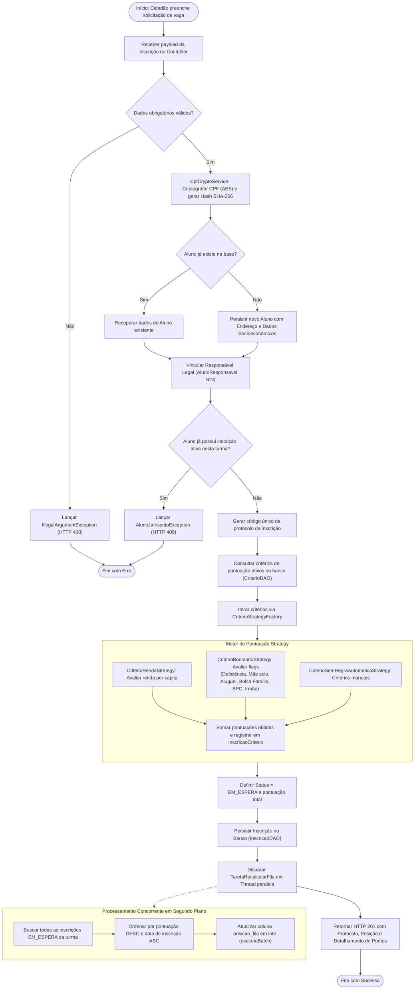

# Diagrama de Atividades — SIVE

O Diagrama de Atividades ilustra o fluxo completo do processo de **Cadastro Familiar, Cálculo de Pontuação e Inscrição na Fila de Espera**, incorporando a criptografia de dados sensíveis (LGPD) e o motor Strategy.

---

## Diagrama (Mermaid)

---

## Principais Etapas e Decisões do Fluxo

1. **Tratamento de Privacidade (LGPD):** O CPF do aluno e dos responsáveis é imediatamente cifrado em formato reversível seguro (`AES-GCM`) para armazenamento e tem um hash (`SHA-256`) gerado para viabilizar pesquisas sem decifrar registros em massa.
2. **Prevenção de Inscrições Duplicadas:** O sistema bloqueia requisições duplicadas para a mesma turma lançando `AlunoJaInscritoException` (HTTP 409).
3. **Cálculo Desacoplado via Strategy:** Cada critério ativo é avaliado por uma estratégia específica, garantindo que novas regras socioeconômicas possam ser introduzidas sem alterar o fluxo principal de inscrição.
4. **Reclassificação Assíncrona:** A fila da turma é reordenada concorrentemente via `TarefaRecalcularFila`, permitindo que a resposta HTTP seja entregue de imediato ao cidadão.
