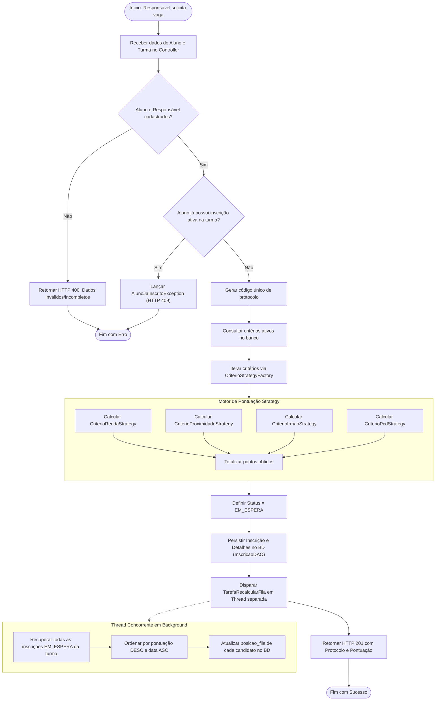

# Diagrama de Atividades — SIVE

O Diagrama de Atividades descreve o fluxo de processo de **Solicitação de Vaga e Processamento da Inscrição**, desde o envio inicial pelo responsável até a inclusão ordenada na fila de espera.

---

## Diagrama (Mermaid)

---

## Principais Decisões e Condições do Fluxo

1. **Validação Preliminar:** Garante que a criança e seus responsáveis legais estejam previamente registrados na base e devidamente associados.
2. **Prevenção de Duplicidade:** Evita que o mesmo aluno tenha duas inscrições ativas concorrentes para a mesma turma.
3. **Cálculo Polimórfico:** Executa dinamicamente as estratégias ativas sem engessar as regras no banco ou na requisição.
4. **Reclassificação Concorrente:** A reclassificação da fila não bloqueia a resposta da requisição REST, sendo delegada para uma thread em background (`Runnable`).

