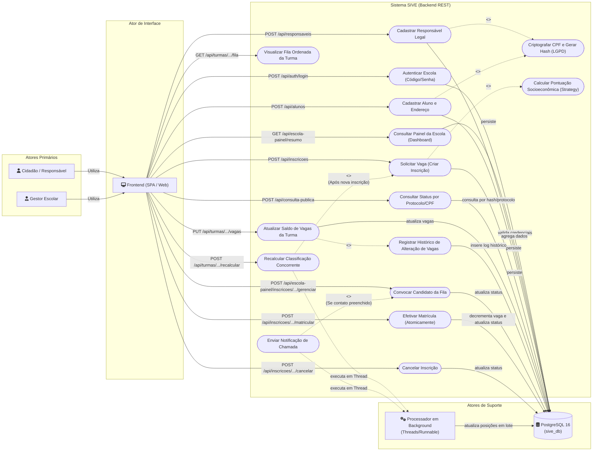

# Diagrama de Casos de Uso — SIVE

O Diagrama de Casos de Uso descreve os atores e suas interações com as funcionalidades do **SIVE (Sistema Integrado de Vagas Escolares)**, atualizado para contemplar autenticação da escola por código/senha, painel gestor da escola, consulta pública com CPF e protocolo, e criptografia/hashing para conformidade com a LGPD.

---

## Atores do Sistema

### Atores Primários (Usuários Humanos)
- **Cidadão / Responsável Legal:** Realiza o cadastro familiar (aluno e responsáveis com criptografia de CPF), seleciona a turma e solicita a vaga, consulta o status e posição ordinal por meio de consulta pública aberta e pode solicitar o cancelamento.
- **Gestor Escolar / Equipe da Escola:** Autentica-se no portal administrativo com código institucional e senha (`/api/auth/login`), visualiza o painel de turmas e ocupação, atualiza saldo de vagas com histórico auditado, convoca candidatos da fila de espera e efetiva matrículas.

### Ator de Interface
- **Frontend (Web / SPA):** Interface do usuário que valida formulários, armazena token de autenticação (Bearer Token) para rotas protegidas da escola e consome os endpoints REST.

### Atores Secundários / Suporte (Infraestrutura)
- **Processador em Background (Threads / Jobs SIVE):** Subsistema concorrente multithread (`Runnable`) para reordenar filas (`TarefaRecalcularFila`), agregar métricas da rede (`TarefaCalcularEstatisticas`) e disparar simulação de avisos de convocação (`TarefaNotificarChamada`).
- **Banco de Dados (PostgreSQL 16):** Banco relacional com 9 tabelas (`escolas`, `turmas`, `responsaveis`, `alunos`, `aluno_responsaveis`, `criterios`, `inscricoes`, `inscricao_criterios`, `historico_vagas`) com controle transacional e integridade referencial.

---

## Diagrama (Mermaid)

---

## Matriz de Rastreabilidade Atualizada

| ID | Caso de Uso | Ator Primário | Ator de Interface | Atores Secundários / Relação | Descrição |
| :--- | :--- | :--- | :--- | :--- | :--- |
| **UC01** | Autenticar Escola | Gestor Escolar | Frontend | Banco de Dados | Valida código e senha (BCrypt) e emite Bearer Token temporário. |
| **UC02** | Consultar Painel da Escola | Gestor Escolar | Frontend | Banco de Dados | Exibe dashboard da escola com totais de vagas, inscritos e chamados. |
| **UC03** | Atualizar Saldo de Vagas | Gestor Escolar | Frontend | Banco de Dados  • *includes* UC_HistVagas | Ajusta vagas totais e disponíveis da turma registrando auditoria. |
| **UC04** | Cadastrar Responsável Legal | Responsável Legal | Frontend | Banco de Dados  • *includes* UC_Cripto | Salva dados com CPF criptografado bidirecional e hash SHA-256 para busca. |
| **UC05** | Cadastrar Aluno e Endereço | Responsável Legal | Frontend | Banco de Dados  • *includes* UC_Cripto | Registra dependente, dados de moradia, renda per capita e vínculo familiar. |
| **UC06** | Solicitar Vaga (Inscrição) | Responsável Legal | Frontend | Banco de Dados, Background  • *includes* UC_CalcPontos  • *extended by* UC_Recalcular | Inscreve candidato na turma, calcula critérios socioeconômicos e gera protocolo. |
| **UC07** | Calcular Pontuação Socioeconômica | *Sistema interno* | — | Banco de Dados | Avalia renda, vulnerabilidade, solo, aluguel, Bolsa Família, BPC e irmão via Strategy. |
| **UC08** | Consulta Pública de Fila | Responsável Legal | Frontend | Banco de Dados | Consulta posição ordinal e status por protocolo ou CPF do aluno/responsável. |
| **UC09** | Recalcular Classificação Concorrente | Gestor Escolar | Frontend | Background, Banco de Dados | Dispara thread assíncrona (`TarefaRecalcularFila`) para reordenar candidatos. |
| **UC10** | Convocar Candidato | Gestor Escolar | Frontend | Banco de Dados, Background  • *extended by* UC_Notificar | Altera status para `CHAMADO` e dispara simulação de notificação via thread. |
| **UC11** | Efetivar Matrícula | Gestor Escolar | Frontend | Banco de Dados | Aloca a vaga com proteção atômica (`synchronized`), decrementando saldo da turma. |
| **UC12** | Cancelar Inscrição | Responsável / Gestor | Frontend | Banco de Dados | Registra desistência formal ou cancelamento da solicitação. |
