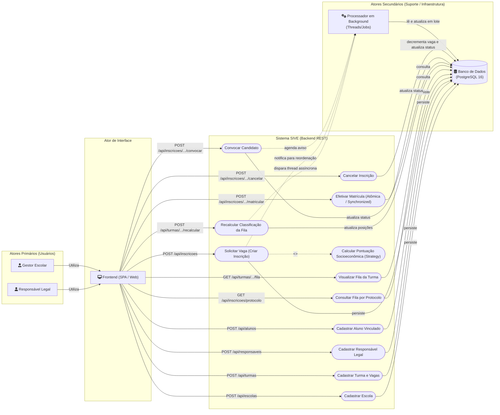

# Diagrama de Casos de Uso — SIVE

O Diagrama de Casos de Uso descreve as interações com o **SIVE (Sistema Integrado de Vagas Escolares)**, detalhando todos os atores envolvidos: atores primários (usuários humanos) e atores secundários/suporte (sistemas externos, frontend, threads de background e banco de dados).

---

## Atores do Sistema

### Atores Primários (Usuários Humanos)
- **Responsável Legal:** Cidadão que cadastra seu perfil, registra os dependentes legais, formaliza solicitações de vagas na escola desejada, consulta o protocolo e pode solicitar o cancelamento.
- **Gestor Escolar / Administrador:** Agente público que cadastra as unidades escolares e turmas, monitora as filas de espera, convoca candidatos e formaliza a efetivação da matrícula.

### Atores Secundários / Suporte (Técnicos e Infraestrutura)
- **Frontend (Interface Web / SPA):** Aplicação cliente que captura os dados digitados pelos usuários, valida formulários em tempo de tela, formata payloads JSON e consome as APIs REST do backend.
- **Processador em Background (Threads / Jobs SIVE):** Subsistema concorrente que executa tarefas demoradas e assíncronas (`Runnable`), como reordenação em lote da fila e simulação de notificações.
- **Banco de Dados (PostgreSQL 16):** Sistema gerenciador de banco de dados relacional que atua como ator de suporte na persistência das entidades, garantia de constraints de integridade e locks transacionais.

---

## Diagrama (Mermaid)

---

## Matriz de Rastreabilidade de Casos de Uso e Atores

| ID | Caso de Uso | Ator Primário | Ator de Interface | Atores Secundários Envolvidos | Descrição |
| :--- | :--- | :--- | :--- | :--- | :--- |
| **UC01** | Cadastrar Escola | Gestor Escolar | Frontend | Banco de Dados | Registra novas escolas e suas capacidades no banco. |
| **UC02** | Cadastrar Turma e Vagas | Gestor Escolar | Frontend | Banco de Dados | Cadastra turmas vinculadas às escolas com número de vagas por turno. |
| **UC03** | Cadastrar Responsável Legal | Responsável Legal | Frontend | Banco de Dados | Registra dados pessoais, renda per capita e telefone do responsável. |
| **UC04** | Cadastrar Aluno Vinculado | Responsável Legal | Frontend | Banco de Dados | Salva dados da certidão, deficiência e o vínculo N:N com responsáveis. |
| **UC05** | Solicitar Vaga (Inscrição) | Responsável Legal | Frontend | Background, Banco de Dados | Cria a inscrição, calcula pontos (`Strategy`), persiste e aciona a reclassificação. |
| **UC06** | Calcular Pontuação Socioeconômica | *Sistema interno* | — | Banco de Dados | Avalia renda, proximidade, irmãos e PCD para somar a pontuação. |
| **UC07** | Consultar Fila por Protocolo | Responsável Legal | Frontend | Banco de Dados | Consulta pública da posição do candidato sem expor dados sensíveis. |
| **UC08** | Visualizar Fila da Turma | Gestor Escolar | Frontend | Banco de Dados | Lista os inscritos da turma ordenados por pontuação decrescente. |
| **UC09** | Recalcular Classificação | Gestor Escolar | Frontend | Background, Banco de Dados | Dispara rotina concorrente via Thread para reordenar toda a fila. |
| **UC10** | Convocar Candidato | Gestor Escolar | Frontend | Background, Banco de Dados | Altera o status para `CHAMADO` e dispara simulação de notificação. |
| **UC11** | Efetivar Matrícula | Gestor Escolar | Frontend | Banco de Dados | Decrementa vaga de forma atômica/sincronizada e fixa o status `MATRICULADO`. |
| **UC12** | Cancelar Inscrição | Responsável / Gestor | Frontend | Banco de Dados | Formaliza a desistência ou anulação da inscrição na fila. |
