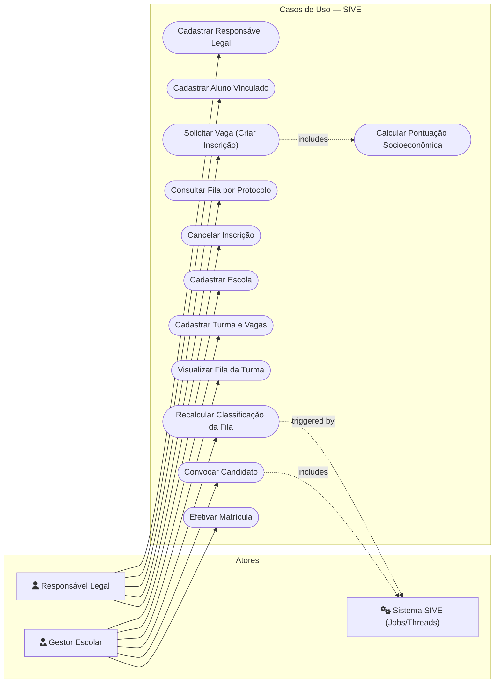

# Diagrama de Casos de Uso — SIVE

O Diagrama de Casos de Uso descreve os atores que interagem com o **SIVE (Sistema Integrado de Vagas Escolares)** e suas interações com as funcionalidades do sistema.

## Atores
- **Responsável Legal:** Cidadão que inscreve o dependente, consulta o andamento da solicitação e formaliza desistência/matrícula.
- **Gestor Escolar / Administrador:** Administrador ou servidor público que cadastra escolas e turmas, monitora a fila de espera, convoca candidatos e dispara o recálculo e auditoria de vagas.
- **Sistema SIVE (Timer / Batch):** Processos automáticos e em segundo plano (threads) para recálculo e notificações.

---

## Diagrama (Mermaid)

---

## Descrição dos Casos de Uso Principais

| ID | Caso de Uso | Ator Principal | Descrição |
| :--- | :--- | :--- | :--- |
| **UC01** | Cadastrar Escola | Gestor Escolar | Cadastra unidades escolares no sistema informando endereço e capacidade total. |
| **UC02** | Cadastrar Turma e Vagas | Gestor Escolar | Cria turmas vinculadas a escolas definindo turno, série e número de vagas. |
| **UC03** | Cadastrar Responsável Legal | Responsável Legal | Registra os dados cadastrais, CPF, contato e renda familiar per capita. |
| **UC04** | Cadastrar Aluno Vinculado | Responsável Legal | Cadastra a criança, dados de certidão, necessidades especiais e o vínculo N:N de parentesco. |
| **UC05** | Solicitar Vaga (Criar Inscrição) | Responsável Legal | Seleciona o aluno e a turma de interesse, gerando um protocolo único. |
| **UC06** | Calcular Pontuação Socioeconômica | Sistema (Strategy) | Avalia renda, proximidade residencial, irmãos e necessidades especiais. |
| **UC07** | Consultar Fila por Protocolo | Responsável Legal | Consulta pública da situação e posição ordinal do candidato na fila. |
| **UC08** | Visualizar Fila da Turma | Gestor Escolar | Lista a ordenação completa de candidatos da turma por pontuação decrescente. |
| **UC09** | Recalcular Classificação | Gestor / Sistema | Executa o recálculo em lote da pontuação e reordenação via thread separada. |
| **UC10** | Convocar Candidato | Gestor Escolar | Altera status para `CHAMADO` e envia aviso para apresentação de documentos. |
| **UC11** | Efetivar Matrícula | Gestor Escolar | Aloca a vaga atomicamente (`synchronized`), decrementando o saldo da turma. |
| **UC12** | Cancelar Inscrição | Responsável / Gestor | Formaliza a desistência ou anulação da solicitação de vaga. |

