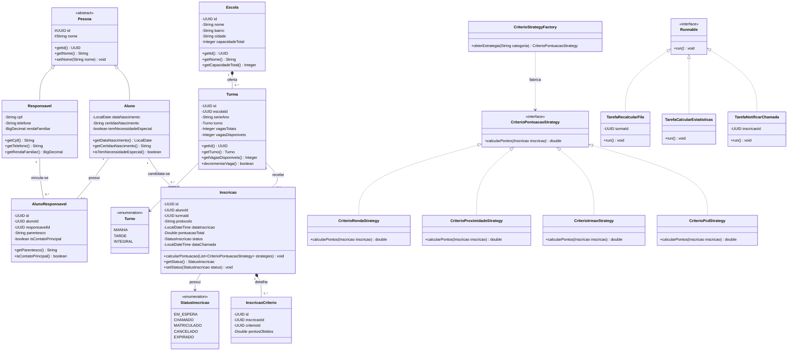

# Diagrama de Classes — SIVE

O Diagrama de Classes representa a estrutura orientada a objetos do domínio do backend do **SIVE**, incluindo a hierarquia de herança (`Pessoa`), associações, enums, contratos do padrão **Strategy** e as tarefas concorrentes.

---

## Diagrama (Mermaid)

---

## Destaques da Modelagem Orientada a Objetos
1. **Herança e Reuso:** `Pessoa` atua como classe base abstrata para `Aluno` e `Responsavel`, compartilhando identificação e atributos comuns.
2. **Encapsulamento e Polimorfismo:** `CriterioPontuacaoStrategy` permite que novos critérios de pontuação socioeconômica sejam plugados sem modificar o fluxo de cálculo da inscrição (Princípio Aberto/Fechado).
3. **Desacoplamento por Concorrência:** As classes do pacote `tarefa` implementam `Runnable` para permitir execução assíncrona gerenciada por threads dedicadas.

