# Diagrama de Classes — SIVE

O Diagrama de Classes representa a estrutura completa orientada a objetos do backend do **SIVE**, incorporando as classes de domínio (`Pessoa`, `Aluno`, `Responsavel`, `Endereco`), o padrão **Strategy** com seus critérios booleanos e de renda, serviços de segurança/LGPD e tarefas assíncronas.

---

## Diagrama (Mermaid)

```mermaid
classDiagram
    %% Hierarquia de Pessoa (Herança e POO)
    class Pessoa {
        <<abstract>>
        #UUID id
        #String nome
        #String cpf
        #String cpfHash
        +getId() UUID
        +getNome() String
        +getCpf() String
        +getCpfHash() String
    }

    class Responsavel {
        -String telefone
        -LocalDateTime createdAt
        +getTelefone() String
    }

    class Aluno {
        -LocalDate dataNascimento
        -Endereco endereco
        -BigDecimal rendaPerCapita
        -boolean temNecessidadeEspecial
        -boolean vulnerabilidadeSocioeconomica
        -boolean responsavelSolo
        -boolean moraDeAluguel
        -boolean bolsaFamilia
        -boolean bpcLoas
        -boolean irmaoMatriculado
        +getDataNascimento() LocalDate
        +getEndereco() Endereco
        +getRendaPerCapita() BigDecimal
        +isTemNecessidadeEspecial() boolean
    }

    class Endereco {
        -String cep
        -String rua
        -String numero
        -String complemento
        -String bairro
        -String cidade
        -String estado
        +getCep() String
        +getCidade() String
    }

    Pessoa <|-- Responsavel
    Pessoa <|-- Aluno
    Aluno *-- Endereco : possui

    %% Associação N:N Aluno e Responsavel
    class AlunoResponsavel {
        -UUID id
        -UUID alunoId
        -UUID responsavelId
        -Parentesco parentesco
        -boolean isContatoPrincipal
        +getParentesco() Parentesco
        +isContatoPrincipal() boolean
    }

    class Parentesco {
        <<enumeration>>
        MAE
        PAI
        AVOS
        TUTOR_LEGAL
        OUTRO
    }

    Aluno "1" -- "0..*" AlunoResponsavel : possui
    Responsavel "1" -- "0..*" AlunoResponsavel : vincula-se
    AlunoResponsavel --> Parentesco : classifica

    %% Estrutura Escolar e Turmas
    class Escola {
        -UUID id
        -String codigo
        -String nome
        -String bairro
        -String cidade
        -Integer capacidadeTotal
        -String senhaHash
        +getId() UUID
        +getCodigo() String
        +getNome() String
    }

    class Turma {
        -UUID id
        -UUID escolaId
        -String serieAno
        -String nome
        -Turno turno
        -int vagasTotais
        -int vagasDisponiveis
        -LocalDateTime dataCriacao
        +getId() UUID
        +getVagasDisponiveis() int
        +decrementarVaga() boolean
    }

    class Turno {
        <<enumeration>>
        MANHA
        TARDE
        INTEGRAL
    }

    class HistoricoVaga {
        -UUID id
        -UUID escolaId
        -UUID turmaId
        -int vagasAnteriores
        -int vagasNovas
        -String motivo
        -LocalDateTime createdAt
    }

    Escola "1" *-- "0..*" Turma : oferta
    Turma --> Turno : possui
    Turma "1" -- "0..*" HistoricoVaga : audita

    %% Inscrições e Fila
    class Inscricao {
        -UUID id
        -UUID alunoId
        -UUID escolaId
        -UUID turmaId
        -String tipoVaga
        -String serieAno
        -Turno turno
        -String protocolo
        -LocalDateTime dataInscricao
        -Double pontuacaoTotal
        -StatusInscricao status
        -LocalDateTime dataChamada
        +getProtocolo() String
        +getStatus() StatusInscricao
        +setPontuacaoTotal(Double pontuacaoTotal) void
    }

    class StatusInscricao {
        <<enumeration>>
        EM_ESPERA
        CHAMADO
        MATRICULADO
        CANCELADO
        EXPIRADO
    }

    class InscricaoCriterio {
        -UUID id
        -UUID inscricaoId
        -UUID criterioId
        -Double pontosObtidos
    }

    class Criterio {
        -UUID id
        -String codigo
        -String nome
        -String descricao
        -Double pontosBase
        -String categoria
        -String tipoResposta
        -boolean ativo
        -int ordem
    }

    Aluno "1" -- "0..*" Inscricao : candidata-se
    Turma "1" -- "0..*" Inscricao : recebe
    Inscricao --> StatusInscricao : possui
    Inscricao "1" *-- "0..*" InscricaoCriterio : detalha
    Criterio "1" -- "0..*" InscricaoCriterio : pontua

    %% Motor de Pontuação Strategy
    class CriterioPontuacaoStrategy {
        <<interface>>
        +calcular(Aluno aluno, Criterio criterio)* Double
    }

    class CriterioRendaStrategy {
        +calcular(Aluno aluno, Criterio criterio) Double
    }

    class CriterioBooleanoStrategy {
        +calcular(Aluno aluno, Criterio criterio) Double
    }

    class CriterioSemRegraAutomaticaStrategy {
        +calcular(Aluno aluno, Criterio criterio) Double
    }

    class CriterioStrategyFactory {
        +obterStrategy(Criterio criterio) CriterioPontuacaoStrategy
    }

    CriterioPontuacaoStrategy <|.. CriterioRendaStrategy
    CriterioPontuacaoStrategy <|.. CriterioBooleanoStrategy
    CriterioPontuacaoStrategy <|.. CriterioSemRegraAutomaticaStrategy
    CriterioStrategyFactory ..> CriterioPontuacaoStrategy : entrega

    %% Camada de Segurança e LGPD
    class CpfCryptoService {
        +encrypt(String cpf) String
        +decrypt(String encryptedCpf) String
        +hash(String cpf) String
        +formatarCpf(String cpf) String
    }

    class PasswordHasher {
        +hashPassword(String rawPassword) String
        +checkPassword(String rawPassword, String hashedPassword) boolean
    }

    class TokenService {
        +gerarToken(UUID escolaId, String codigoEscola) String
        +validarToken(String token) boolean
    }

    %% Concorrência (Threads / Runnable)
    class Runnable {
        <<interface>>
        +run()* void
    }

    class TarefaRecalcularFila {
        -UUID turmaId
        -int totalReordenados
        +run() void
    }

    class TarefaCalcularEstatisticas {
        -EstatisticasDAO estatisticasDAO
        -EstatisticasRede resultado
        +run() void
    }

    class TarefaNotificarChamada {
        -UUID inscricaoId
        -boolean sucesso
        +run() void
    }

    Runnable <|.. TarefaRecalcularFila
    Runnable <|.. TarefaCalcularEstatisticas
    Runnable <|.. TarefaNotificarChamada
```

---

## Destaques da Modelagem Orientada a Objetos Atualizada

1. **Herança com Proteção de Dados (`Pessoa`):** `Aluno` e `Responsavel` compartilham a superclasse `Pessoa`, que centraliza atributos de identificação (`id`, `nome`, `cpf` criptografado e `cpfHash`).
2. **Objeto de Valor (Value Object):** `Endereco` encapsula dados postais e geográficos do aluno de forma coesa.
3. **Padrão Strategy Dinâmico:** `CriterioStrategyFactory` seleciona a estratégia (`CriterioRendaStrategy`, `CriterioBooleanoStrategy` para flags como deficiência, vulnerabilidade e irmão, ou `CriterioSemRegraAutomaticaStrategy`).
4. **Segurança e Criptografia:** Módulos utilitários `CpfCryptoService` (AES/SHA-256) e `PasswordHasher` (BCrypt).
5. **Auditoria de Vagas:** Entidade `HistoricoVaga` para rastreamento de alterações de saldo e capacidade nas turmas.
