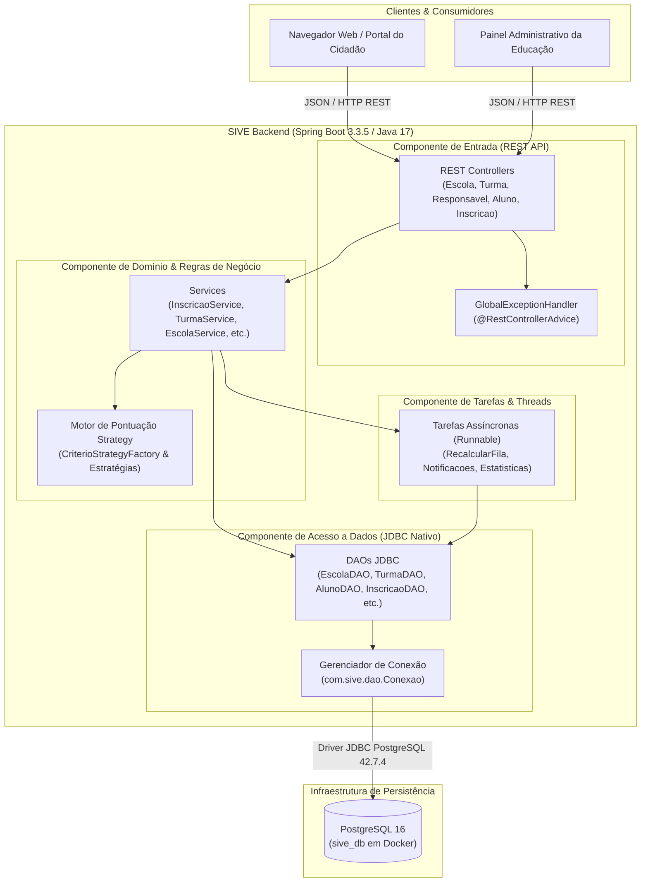

# Diagrama de Componentes — SIVE

O Diagrama de Componentes apresenta a divisão de blocos executáveis e subsistemas de software do **SIVE**, ilustrando a comunicação entre a camada externa de consumo HTTP, o servidor Spring Boot e a persistência de dados.

---

## Diagrama (Mermaid)

---

## Detalhamento dos Componentes

- **Componente de Entrada (REST API):** Ponto de terminação HTTP. Controladores recebem e validam DTOs e cargas úteis JSON, enquanto o `GlobalExceptionHandler` unifica os erros 400, 404, 409 e 500.
- **Componente de Domínio & Regras de Negócio:** Contém os serviços que coordenam o ciclo de vida das inscrições, a sincronização do saldo de vagas (`synchronized`) e a invocação polimórfica de estratégias de pontuação.
- **Componente de Tarefas & Threads:** Isola tarefas demoradas e intensivas de I/O em threads em background com sincronização por `start()` e `join()`.
- **Componente de Acesso a Dados:** Utiliza JDBC nativo via `java.sql` com transações manuais para evitar *overhead* de ORM e garantir controle atômico rigoroso nas operações de reserva de vagas.
- **PostgreSQL 16:** Banco de dados relacional orquestrado via Docker Compose, com constraints de integridade referencial e chaves estrangeiras.

