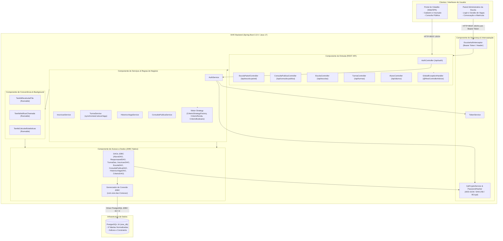

# Diagrama de Componentes — SIVE

O Diagrama de Componentes apresenta a divisão modular do sistema **SIVE**, incluindo os portais de consumo, módulos de autenticação/segurança, processamento assíncrono e banco de dados relacional.

---

## Diagrama (Mermaid)

---

## Descrição dos Módulos Principais

- **Componente de Segurança & Interceptação:**
  - `EscolaAuthInterceptor`: intercepta e protege endpoints administrativos exigindo token válido (`Authorization: Bearer <token>`).
  - `CpfCryptoService`: cifra e decifra CPFs com AES e gera hashes determinísticos em SHA-256 para buscas diretas sem expor dados pessoais (LGPD).
  - `PasswordHasher`: valida senhas criptografadas com salt via algoritmo BCrypt.
- **Componente de Entrada (REST API):** Endpoints segmentados por domínio funcional (autenticação, painel gestor, consulta pública com CAPTCHA/busca segura, CRUD de escolas e turmas).
- **Componente de Concorrência:** Isola rotas pesadas em threads em background com sincronização por `join()` e execução assíncrona.
- **Componente de Acesso a Dados (JDBC Nativo):** Transações manuais via `java.sql` garantindo consistência estrita sem abstrações pesadas de ORM.
