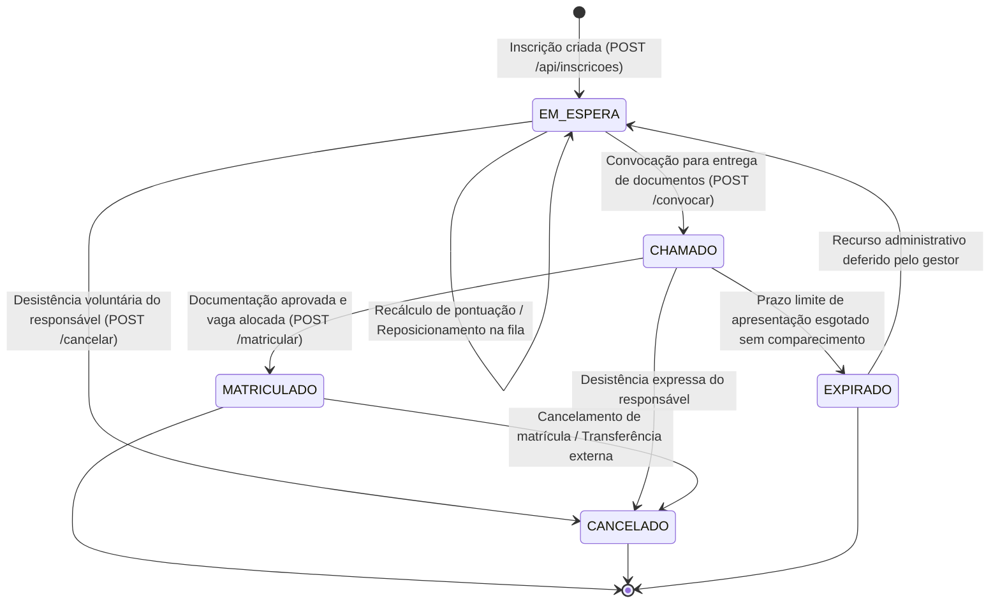

# Diagrama de Estados — SIVE

O Diagrama de Estados descreve o ciclo de vida e as transições possíveis da entidade central **Inscrição** (`StatusInscricao`) no sistema **SIVE**.

---

## Diagrama (Mermaid)

---

## Detalhamento dos Estados e Transições

| Estado | Significado | Próximos Estados Válidos | Gatilho / Ação |
| :--- | :--- | :--- | :--- |
| **`EM_ESPERA`** | Candidato registrado aguardando vaga, com posição ordinal calculada na fila. | `CHAMADO`, `CANCELADO`, `EM_ESPERA` | Criação da inscrição ou recálculo periódico. |
| **`CHAMADO`** | Candidato convocado para comparecimento presencial e validação de documentos comprobatórios. | `MATRICULADO`, `EXPIRADO`, `CANCELADO` | Acionado pelo gestor quando há vaga disponível (`/convocar`). |
| **`MATRICULADO`** | Processo concluído com êxito; o aluno ocupa oficialmente a vaga na turma. | `CANCELADO` | Acionado pelo gestor (`/matricular`) decrementando vagas de modo atômico. |
| **`EXPIRADO`** | O prazo para apresentação presencial expirou sem manifestação do responsável. | `EM_ESPERA` (exceção/recurso) | Rotina de auditoria de prazos. |
| **`CANCELADO`** | Inscrição cancelada por desistência do responsável ou duplicidade/fraude documental. | *Estado final* | Acionado pelo responsável ou gestor (`/cancelar`). |

> **Nota de Validação:** Transições não mapeadas acima (ex.: tentar passar diretamente de `EM_ESPERA` para `MATRICULADO` sem convocação) disparam a exceção customizada `StatusInvalidoException` com resposta HTTP 400.

