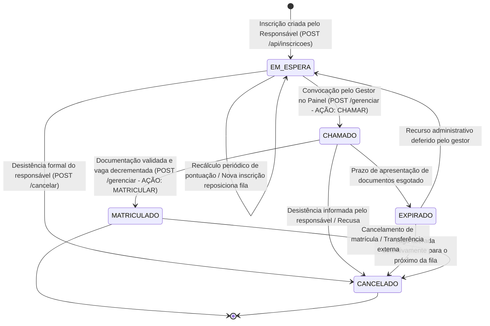

# Diagrama de Estados — SIVE

O Diagrama de Estados descreve o ciclo de vida completo da entidade central **Inscrição** (`StatusInscricao`) no **SIVE**, incluindo as ações do painel gestor da escola, prazos e controle de consistência.

---

## Diagrama (Mermaid)

---

## Detalhamento dos Estados e Transições

| Estado | Significado no Sistema | Transições Válidas | Gatilho / Ação Responsável |
| :--- | :--- | :--- | :--- |
| **`EM_ESPERA`** | Candidato classificado na fila de espera da turma aguardando surgimento de vagas. | `CHAMADO`, `CANCELADO`, `EM_ESPERA` | Criação da solicitação de vaga ou recálculo concorrente via `TarefaRecalcularFila`. |
| **`CHAMADO`** | Candidato formalmente convocado pela unidade escolar para comparecimento presencial com documentos. | `MATRICULADO`, `EXPIRADO`, `CANCELADO` | Disparado pelo gestor no Painel da Escola; registra data de chamada e inicia simulação de notificação (`TarefaNotificarChamada`). |
| **`MATRICULADO`** | Aluno matriculado com sucesso. Vaga ocupada de modo atômico e sincronizado no banco de dados. | `CANCELADO` | Disparado pelo gestor escolar via `/api/escola-painel/inscricoes/{id}/gerenciar` com ação `MATRICULAR`. |
| **`EXPIRADO`** | O candidato não compareceu dentro do prazo legal estipulado para validação de documentos. | `EM_ESPERA`, `CANCELADO` | Rotina de controle de prazos ou ação de expiração pelo gestor. |
| **`CANCELADO`** | Inscrição formalmente encerrada por solicitação do responsável ou reprovação documental definitiva. | *Estado terminal* | Rota `/api/inscricoes/{id}/cancelar` ou ação `RECUSAR` no painel da escola. |

> **Controle de Integridade:** Tentativas de transição inválida (ex.: ir diretamente de `EM_ESPERA` para `MATRICULADO` sem convocação prévia) são barradas por `StatusInvalidoException` com retorno HTTP 400.
