# Diagrama de Pacotes — SIVE

O Diagrama de Pacotes documenta a organização modular do código-fonte Java (`com.sive`) e a dependência direta entre camadas arquiteturais, respeitando o princípio de responsabilidade única.

---

## Diagrama (Mermaid)

```mermaid
flowchart TD
    subgraph com_sive["com.sive"]
        App["SiveApplication.java"]

        subgraph controller["controller"]
            EscolaController["EscolaController"]
            TurmaController["TurmaController"]
            ResponsavelController["ResponsavelController"]
            AlunoController["AlunoController"]
            InscricaoController["InscricaoController"]
            GlobalExceptionHandler["GlobalExceptionHandler"]
        end

        subgraph service["service"]
            EscolaService["EscolaService"]
            TurmaService["TurmaService"]
            ResponsavelService["ResponsavelService"]
            AlunoService["AlunoService"]
            InscricaoService["InscricaoService"]
        end

        subgraph strategy["strategy"]
            CriterioStrategy["CriterioPontuacaoStrategy"]
            CriterioFactory["CriterioStrategyFactory"]
            CriteriosImpl["CriterioRenda / Proximidade / Irmao / Pcd"]
        end

        subgraph tarefa["tarefa"]
            TarefaRecalcularFila["TarefaRecalcularFila"]
            TarefaCalcularEstatisticas["TarefaCalcularEstatisticas"]
            TarefaNotificarChamada["TarefaNotificarChamada"]
        end

        subgraph dao["dao"]
            Conexao["Conexao"]
            EscolaDAO["EscolaDAO"]
            TurmaDAO["TurmaDAO"]
            ResponsavelDAO["ResponsavelDAO"]
            AlunoDAO["AlunoDAO"]
            InscricaoDAO["InscricaoDAO"]
        end

        subgraph model["model"]
            Pessoa["Pessoa"]
            Responsavel["Responsavel"]
            Aluno["Aluno"]
            AlunoResponsavel["AlunoResponsavel"]
            Escola["Escola"]
            Turma["Turma"]
            Inscricao["Inscricao"]
            StatusInscricao["StatusInscricao (Enum)"]
            Turno["Turno (Enum)"]
        end

        subgraph exception["exception"]
            SiveException["SiveException"]
            VagaIndisponivelException["VagaIndisponivelException"]
            AlunoJaInscritoException["AlunoJaInscritoException"]
            InscricaoNaoEncontradaException["InscricaoNaoEncontradaException"]
            StatusInvalidoException["StatusInvalidoException"]
        end
    end

    %% Relações e Dependências de Pacotes
    controller --> service
    controller --> exception
    controller --> model

    service --> dao
    service --> strategy
    service --> tarefa
    service --> exception
    service --> model

    strategy --> model
    tarefa --> dao
    tarefa --> model
    dao --> model

    App --> controller
    App --> service
```

---

## Descrição das Camadas e Regras de Dependência

| Pacote | Responsabilidade | Depende de |
| :--- | :--- | :--- |
| `com.sive.controller` | Endpoints REST, mapeamento de requisições/respostas HTTP e tratamento global de exceções. | `service`, `model`, `exception` |
| `com.sive.service` | Regras de negócio, cálculo de pontuação, transações, concorrência e validações. | `dao`, `strategy`, `tarefa`, `model`, `exception` |
| `com.sive.strategy` | Implementações do padrão Strategy para cálculo de critérios socioeconômicos. | `model` |
| `com.sive.tarefa` | Classes `Runnable` executadas em threads separadas para processamento assíncrono. | `dao`, `model` |
| `com.sive.dao` | Acesso a dados via JDBC nativo (`java.sql`), mapeamento de ResultSet para POJOs. | `model` |
| `com.sive.model` | Entidades POJO de domínio e enums. Pacote folha, sem dependências externas. | Nenhuma |
| `com.sive.exception` | Hierarquia de exceções de domínio. Pacote compartilhado transversalmente. | Nenhuma |

