# Diagrama de Pacotes — SIVE

O Diagrama de Pacotes documenta a arquitetura de módulos do backend em `com.sive`, ilustrando o isolamento de responsabilidades entre controladores, serviços de aplicação, regras de segurança, persistência e modelos.

---

## Diagrama (Mermaid)

```mermaid
flowchart TD
    subgraph com_sive["com.sive"]
        App["SiveApplication.java"]

        subgraph security["security"]
            AuthInterceptor["EscolaAuthInterceptor"]
            TokenService["TokenService"]
            CryptoService["CpfCryptoService"]
            PwdHasher["PasswordHasher"]
            WebConfig["WebConfig"]
        end

        subgraph controller["controller"]
            AuthController["AuthController"]
            EscolaPainelCtrl["EscolaPainelController"]
            ConsultaCtrl["ConsultaPublicaController"]
            EscolaController["EscolaController"]
            TurmaController["TurmaController"]
            AlunoController["AlunoController"]
            ResponsavelController["ResponsavelController"]
            HealthController["HealthController"]
            GlobalHandler["GlobalExceptionHandler"]
        end

        subgraph service["service"]
            AuthService["AuthService"]
            EscolaPainelSvc["EscolaPainelService / EscolaService"]
            TurmaService["TurmaService"]
            AlunoService["AlunoService"]
            ResponsavelService["ResponsavelService"]
            InscricaoService["InscricaoService"]
            ConsultaService["ConsultaPublicaService"]
            HistoricoService["HistoricoVagaService"]
            CriterioService["CriterioService"]
        end

        subgraph strategy["strategy"]
            CriterioStrategy["CriterioPontuacaoStrategy (Interface)"]
            StrategyFactory["CriterioStrategyFactory"]
            CriterioRenda["CriterioRendaStrategy"]
            CriterioBooleano["CriterioBooleanoStrategy"]
            CriterioSemRegra["CriterioSemRegraAutomaticaStrategy"]
        end

        subgraph tarefa["tarefa"]
            TarefaRecalcular["TarefaRecalcularFila"]
            TarefaEstatisticas["TarefaCalcularEstatisticas"]
            TarefaNotificar["TarefaNotificarChamada"]
        end

        subgraph dao["dao"]
            Conexao["Conexao"]
            EscolaDAO["EscolaDAO"]
            TurmaDao["TurmaDao"]
            AlunoDAO["AlunoDAO"]
            ResponsavelDAO["ResponsavelDAO"]
            AlunoRespDAO["AlunoResponsavelDAO"]
            InscricaoDAO["InscricaoDAO"]
            InscricaoCritDAO["InscricaoCriterioDAO"]
            ConsultaDAO["ConsultaPublicaDAO"]
            HistoricoDAO["HistoricoVagaDAO"]
            EstatisticasDAO["EstatisticasDAO"]
            CriterioDAO["CriterioDAO"]
        end

        subgraph model["model"]
            Pessoa["Pessoa (Abstrata)"]
            Aluno["Aluno"]
            Responsavel["Responsavel"]
            Endereco["Endereco"]
            Escola["Escola"]
            Turma["Turma"]
            HistoricoVaga["HistoricoVaga"]
            Inscricao["Inscricao"]
            Criterio["Criterio"]
            Enums["Turno, StatusInscricao, Parentesco"]
            DTOs["Requests e Responses (Painel, Login, Consulta)"]
        end

        subgraph exception["exception"]
            SiveException["SiveException"]
            AutenticacaoException["AutenticacaoException"]
            AcessoNegadoException["AcessoNegadoException"]
            VagaIndisponivelException["VagaIndisponivelException"]
            AlunoJaInscritoException["AlunoJaInscritoException"]
            InscricaoNaoEncontradaException["InscricaoNaoEncontradaException"]
            StatusInvalidoException["StatusInvalidoException"]
        end
    end

    %% Relações e Dependências de Pacotes
    controller --> security
    controller --> service
    controller --> model
    controller --> exception

    service --> security
    service --> dao
    service --> strategy
    service --> tarefa
    service --> model
    service --> exception

    security --> exception
    security --> model

    strategy --> model
    tarefa --> dao
    tarefa --> model
    dao --> security
    dao --> model

    App --> controller
    App --> service
```

---

## Matriz de Camadas e Dependências

| Pacote | Responsabilidade | Dependências Permitidas |
| :--- | :--- | :--- |
| `com.sive.controller` | Endpoints REST, mapeamento de payloads JSON, status HTTP e captura global de erros. | `service`, `security`, `model`, `exception` |
| `com.sive.security` | Interceptação HTTP (`HandlerInterceptor`), validação de tokens JWT/Bearer, hashing e criptografia AES de dados pessoais (LGPD). | `model`, `exception` |
| `com.sive.service` | Orquestração das regras de negócio, controle transacional, alocação de vagas e cálculo de pontuação. | `dao`, `strategy`, `tarefa`, `security`, `model`, `exception` |
| `com.sive.strategy` | Implementações do padrão comportamental Strategy para cálculo dinâmico de pontuação de critérios. | `model` |
| `com.sive.tarefa` | Classes `Runnable` executadas em threads dedicadas assíncronas. | `dao`, `model` |
| `com.sive.dao` | Acesso nativo a dados via `java.sql` (JDBC), montagem de PreparedStatement e conversão de ResultSet. | `security` (para hashing/cifra), `model` |
| `com.sive.model` | Entidades de domínio, objetos de valor (Value Objects), DTOs de requisição/resposta e Enums. | Nenhuma (pacote folha) |
| `com.sive.exception` | Hierarquia de exceções customizadas de regras de negócio e segurança. | Nenhuma |
