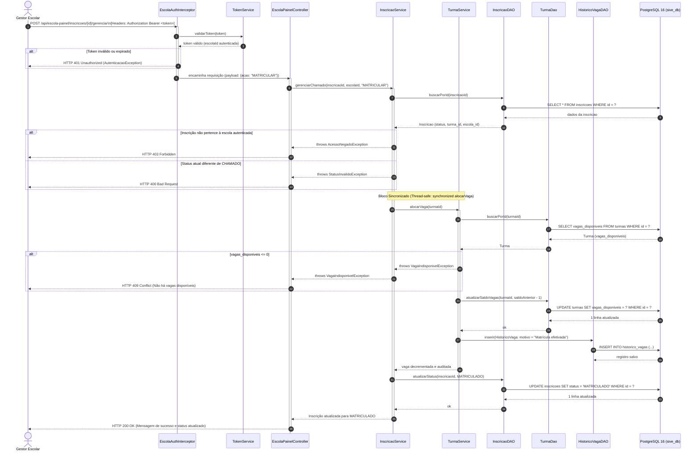

# Diagrama de Sequência — SIVE

O Diagrama de Sequência ilustra a operação crítica do painel da escola para **Gerenciamento de Inscrição: Convocação, Concorrência e Efetivação de Matrícula** (`POST /api/escola-painel/inscricoes/{id}/gerenciar`), exibindo a validação de token, segurança, auditoria e controle contra condições de corrida (*race conditions*).

---

## Diagrama (Mermaid)

---

## Aspectos Arquiteturais Evidenciados

1. **Autenticação e Autorização por Interceptor:** Toda requisição ao painel é interceptada e validada pelo `EscolaAuthInterceptor` através do token de sessão antes de alcançar o controlador.
2. **Isolamento Multitenant por Escola:** A `InscricaoService` valida se a inscrição gerenciada pertence estritamente à escola vinculada ao token autenticado (`AcessoNegadoException` com HTTP 403 em caso de violação).
3. **Prevenção de Condições de Corrida (*Race Conditions*):** A execução do método `TurmaService.alocarVaga` é protegida com `synchronized`, assegurando que requisições concorrentes não ultrapassem o limite de capacidade da turma.
4. **Auditoria Contínua:** Toda mudança na quantidade de vagas disponíveis gera um registro imutável em `historico_vagas`.
