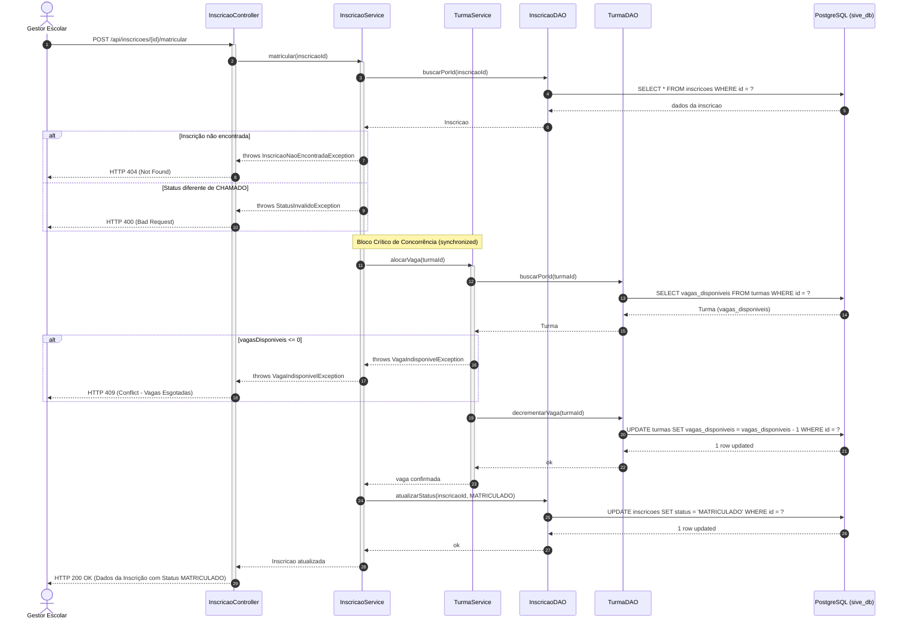

# Diagrama de Sequência — SIVE

O Diagrama de Sequência detalha a troca de mensagens para a operação crítica de **Efetivação de Matrícula com Controle de Concorrência** (`POST /api/inscricoes/{id}/matricular`), demonstrando a proteção contra condições de corrida (*race conditions*) no decremento de vagas.

---

## Diagrama (Mermaid)

---

## Aspectos Críticos Ilustrados no Fluxo

1. **Validação de Pré-condição:** Apenas inscrições que já estão no status `CHAMADO` podem ser migradas para `MATRICULADO`. Caso contrário, uma `StatusInvalidoException` é capturada pelo `GlobalExceptionHandler` gerando HTTP 400.
2. **Prevenção de Race Condition:** A chamada para `TurmaService.alocarVaga(...)` é protegida com `synchronized` para que duas requisições simultâneas não tentem alocar a última vaga disponível ao mesmo tempo.
3. **Atomicidade:** A validação de disponibilidade e o decremento no banco ocorrem de forma consistente antes da transição do status da inscrição.

